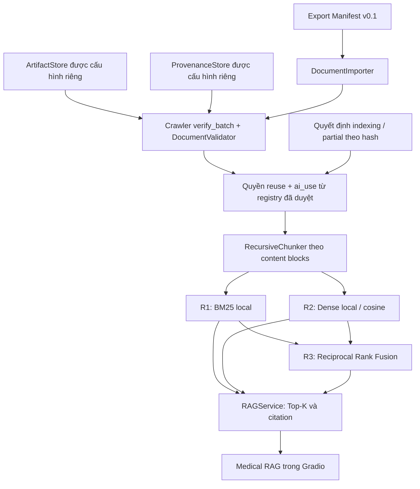

# WP6A — Nền tảng Medical RAG Hybrid Retrieval

## 1. Phạm vi và kiến trúc

WP6A tìm **đoạn văn bản có nguồn** để người dùng kiểm tra. Hệ thống chưa sinh câu trả lời
y khoa, chưa gọi LLM và không yêu cầu `OPENROUTER_API_KEY`. Computer Vision vẫn sử dụng
SegFormer và Faster R-CNN theo registry hiện có; không đổi checkpoint hoặc trang CV.



Mỗi phiên Gradio sở hữu một `RAGService`. Index từ khóa và ma trận vector nằm trong RAM
của máy chạy ứng dụng; không dùng vector database hay API bên ngoài. Không lưu index lâu
dài trong WP6A. Khi khởi động lại, phiên đọc lại dữ liệu đã cấu hình. Model embedding được
nạp lười khi chọn Dense/Hybrid; BM25 không cần torch/transformers.

## 2. Vai trò từng file

| File | Vai trò |
| --- | --- |
| `app/rag/models.py` | Document, Chunk, SearchHit, SearchResponse, ImportResult và mã lỗi an toàn. |
| `app/rag/importer.py` | Binding store, chống traversal, kiểm chứng batch, đọc đúng byte đã băm; DocumentValidator dùng schema Crawler. |
| `app/rag/rights.py` | RegistryRights: kiểm tra quyền và quyết định indexing đang có hiệu lực. |
| `app/rag/synthetic.py` | Corpus tự viết cố định, generator và SyntheticRights chỉ nhận đúng hash/nội dung đó. |
| `app/rag/chunking.py` | ChunkConfig, RecursiveChunker, heading hierarchy và vị trí citation. |
| `app/rag/retrieval.py` | BM25Retriever, LocalE5Embedder, DenseRetriever, RRFusion, HybridRetriever. |
| `app/rag/service.py` | Vòng đời index, cập nhật, loại bỏ, xác minh lại và giao diện search chung. |
| `app/rag/runtime.py` | Đọc cấu hình do operator đặt; tạo service riêng cho từng phiên. |
| `app/rag/__main__.py` | CLI kiểm tra retrieval, không mở web hoặc gọi LLM. |
| `app/ui/rag_page.py` | Ô hỏi, mode, Top-K, Search, đoạn văn và citation; escape HTML từ nguồn. |
| `app/ui/shell.py`, `app/ui/overview.py` | Thêm điều hướng Medical RAG và cập nhật trạng thái module. |
| `config/rag.example.json` | Mẫu binding và tham số; các đường dẫn mẫu phải được thay bằng cấu hình thật. |
| `requirements-rag.txt` | Dependency importer: Crawler tại commit cố định, kèm dependencies app. |
| `requirements-rag-dense.txt` | Dependencies Dense tùy chọn; không chứa model weights. |
| `tests/rag_support.py`, `tests/test_rag_*.py` | Fixtures tổng hợp, kiểm thử importer, chunking, retrieval, lifecycle, UI và Chromium. |
| `README.md` | Lệnh chạy demo nhanh và liên kết tài liệu WP6A. |
| `docs/WP6A_RAG_FOUNDATION.md` | Thiết kế, trust boundary, cách chạy, kiểm thử và giới hạn. |

`app/rag/__init__.py` chỉ đánh dấu package. Không module nào trong RAG import Computer Vision.

## 3. Chạy demo tổng hợp

Từ thư mục gốc repository, dùng Python 3.11+ và môi trường `.venv` của dự án:

```powershell
.venv\Scripts\python.exe -m pip install -r requirements-rag.txt
.venv\Scripts\python.exe -m app.rag --demo --mode BM25 --query 'tổn thương da' --top-k 3
```

CLI tạo ba record tự viết, original và provenance trong thư mục tạm riêng, xác minh rồi
tìm kiếm. Mọi record và kết quả demo đều có nhãn **SYNTHETIC DEMO**. Câu trong corpus chỉ
là ví dụ kiểm thử từ vựng, không phải tài liệu y khoa hay hướng dẫn chẩn đoán/điều trị.

Chạy Main System:

```powershell
Remove-Item Env:RAG_CONFIG -ErrorAction SilentlyContinue
$env:RAG_SYNTHETIC_DEMO = '1'
.venv\Scripts\python.exe main.py
```

Mở địa chỉ localhost của app, chọn **Medical RAG**, nhập câu hỏi và bấm **Search**.
Trang hiển thị title, source locator, chunk ID, score, block range, citation metadata,
mode và thời gian. Score không phải xác suất chẩn đoán. Khi không có kết quả, app thông báo
rõ. Tắt demo bằng `Remove-Item Env:RAG_SYNTHETIC_DEMO`.

Không có biến cấu hình RAG thì index rỗng. Browser không được chọn đường dẫn file,
upload manifest, thay quyền hoặc chuyển sang corpus của phiên khác. Cấu hình demo và
cấu hình dữ liệu thật loại trừ nhau. Đóng/thu hồi state theo TTL sẽ dọn corpus tạm của phiên;
query không được ghi log hay lưu thành lịch sử dùng chung.

## 4. Import dữ liệu Crawler

Đã đọc và đối chiếu `docs/DATA_CONTRACT.md`, `docs/SOURCE_POLICY.md`,
`structured-raw-0.1.json` và `export-manifest-0.1.json` của Crawler, tại commit
`1bcfb69ef8dc6991e206c5874b02779b6297204f`.
[Data contract](https://github.com/Le-Chi-Bao/Medical-Data-Crawler/blob/1bcfb69ef8dc6991e206c5874b02779b6297204f/docs/DATA_CONTRACT.md),
[source policy](https://github.com/Le-Chi-Bao/Medical-Data-Crawler/blob/1bcfb69ef8dc6991e206c5874b02779b6297204f/docs/SOURCE_POLICY.md).
Không sửa repo Crawler. Dependency được cài từ commit này, không dùng đường dẫn sibling
của máy tác giả làm phụ thuộc runtime.

Operator sao chép `config/rag.example.json` thành cấu hình riêng rồi cung cấp năm đường dẫn:

| Khóa | Ý nghĩa |
| --- | --- |
| `manifest` | `.../<batch_id>/manifest.json`, batch_id phải khớp manifest. |
| `artifacts` | Root ArtifactStore chứa file tên SHA-256, không bắt buộc nằm trong batch. |
| `provenance` | Root ProvenanceStore chứa `<event_id>.json`, độc lập với batch. |
| `registry` | Snapshot source registry v0.1 do reviewer kiểm soát. |
| `approvals` | Quyết định indexing WP6A do reviewer kiểm soát, mô tả ở phần tiếp. |

Đường dẫn tương đối trong JSON tính từ thư mục chứa **file cấu hình**, không phải working
directory hay thư mục manifest. Ba root dữ liệu phải tồn tại; importer không tự tạo store
thật hoặc suy đoán vị trí original/provenance.

```powershell
Remove-Item Env:RAG_SYNTHETIC_DEMO -ErrorAction SilentlyContinue
$env:RAG_CONFIG = 'E:\private-rag-config\rag.json'
.venv\Scripts\python.exe main.py
# Hoặc chạy CLI cùng cấu hình:
.venv\Scripts\python.exe -m app.rag --config $env:RAG_CONFIG --mode BM25 --query 'câu hỏi'
```

Trong Python:

```python
from pathlib import Path
from app.rag.importer import DocumentImporter, StoreBindings
from app.rag.rights import RegistryRights
from app.rag.service import RAGService

policy = RegistryRights(Path('/reviewed/registry.json'), Path('/reviewed/approvals.json'))
importer = DocumentImporter(StoreBindings(Path('/artifacts'), Path('/provenance')), policy)
service = RAGService()
report = service.ingest(Path('/batches/BATCH_ID/manifest.json'), importer)
response = service.search('câu hỏi', mode='BM25', top_k=5)
service.remove_document('doc:...')
service.close()
```

Các đường dẫn trên minh họa interface, không phải nguồn dữ liệu kèm sẵn. `report` chỉ trả
mã từ chối và document ID, không trả nội dung bị từ chối. `INVALID`: lỗi schema/integrity
hoặc thiếu verifier/store; không có document được trả. `BLOCKED`: batch qua integrity
nhưng có record bị chặn extraction/quyền; chỉ các record đủ điều kiện xuất hiện trong
`documents`. `VERIFIED`: toàn bộ record xuất đã qua mọi gate bắt buộc. Omissions được
verifier đối chiếu theo contract và không trở thành document/chunk. Runtime khởi tạo UI/CLI
chỉ nhận batch `VERIFIED`; API ingest cho phép caller xem báo cáo các record bị chặn.

Importer dùng `medical_data_crawler.export.verify_batch()` chính thức: schema, thống kê,
byte size/hash record, liên kết manifest–record–event–original, original checksum/size,
omission event và file ngoài danh sách trong `records/`. Sau đó importer đọc lại đúng
record/provenance đang dùng, đối chiếu hash và bindings. Giới hạn mặc định 16 MiB cho mỗi
JSON qua verifier; original được verifier băm theo stream. Traversal, drive Windows,
alternate data stream, symlink/junction phía dưới root đều bị chặn.

Verifier kiểm tra **tính nhất quán file**, không xác thực bằng chữ ký hoặc chứng minh tác
giả/bản quyền. Manifest và provenance hiện chưa được ký; sửa đồng bộ nhiều file có thể
vượt integrity. Store và file quyết định phải do operator tin cậy quản lý, không cho
người gửi batch tự cung cấp quyền sử dụng.

## 5. Kiểm soát quyền và cập nhật

Record v0.1 chỉ có `rights.reuse`, **không có `ai_use`**. `reuse=permitted` trong record
vẫn bị chặn nếu không có quyền AI độc lập. RegistryRights gọi validator và
`allows_asset_use()` của Crawler cho `read`, `internal_storage`, `reuse`, `ai_use`, đúng
source ID, locator, loại `html_text`/`pdf_text` và thời điểm hiện tại. Review hết hạn,
đang chờ duyệt, nguồn sai URL, thiếu bằng chứng hoặc quyền unknown/restricted/denied đều
đóng gate. Metadata-only và nguồn PubMed không được xem như full-text; WP6A chặn nguồn
PubMed và media type ngoài HTML/PDF trong đường import production.

Reviewer phải cung cấp quyết định indexing theo **đúng phiên bản record**, ngoài registry:

```json
{
  "version": "wp6a-indexing-1",
  "documents": [
    {
      "document_id": "doc:<64 lowercase hex from manifest>",
      "record_sha256": "<64 lowercase hex from manifest>",
      "original_sha256": "<64 lowercase hex from manifest>",
      "source_id": "<exact reviewed source_id>",
      "locator": "<exact reviewed locator>",
      "indexing": "allowed",
      "content_scope": "full_text",
      "partial": "denied",
      "reviewer_id": "reviewer-<internal-id>",
      "evidence": "<reference to the reviewed indexing purpose and evidence>",
      "reviewed_at": "2026-11-25T00:00:00Z",
      "review_again_at": "2026-12-25T00:00:00Z"
    }
  ]
}
```

Các chuỗi `<...>` là placeholder nên không thể cấp quyền cho record thực. Reviewer phải
đối chiếu bằng chứng, phạm vi AI/indexing, privacy và thẩm quyền trước khi ghi quyết định;
chương trình chỉ kiểm tra quyết định đã ghi, không tự suy ra quyền từ việc tải được tài liệu.
`content_scope=full_text` xác nhận loại nội dung được review, không tự biến abstract thành
full-text. Trường `partial=allowed` chỉ dùng sau khi reviewer duyệt phần thiếu/cảnh báo của
đúng record; mặc định partial bị chặn. Extraction `failed` luôn bị loại.

Mỗi query xác minh lại các manifest đã nhập, original/provenance và quyền từ file hiện tại.
Thay nội dung làm đổi record hash nên cần quyết định indexing mới; chunks cũ bị loại.
Thu hồi bằng registry, đổi `indexing` thành `revoked`, xóa grant, làm review hết hạn hoặc
gọi `remove_document()` đều ngăn tài liệu xuất hiện ở lần search tiếp theo. Vector cache
bị xóa khi tập chunk thay đổi. Receipt mới của cùng document ID thay thế receipt cũ;
không quay lại phiên bản cũ chỉ vì phiên bản mới mất quyền. Gọi ingest có chủ đích để
khôi phục tài liệu đã remove. Exact duplicate được gộp; cùng ID nhưng hai record hash
khác nhau trong một batch làm batch INVALID.

Index và corpus trong RAM được cập nhật khi có thao tác; không có daemon theo dõi quyền
ngoài phiên. Đoạn đã trả cho browser trước khi thu hồi không thể bị xóa khỏi trí nhớ/cache
browser từ phía server; lần query sau áp dụng quyền mới. Operator cần dừng phiên khi có
yêu cầu thu hồi ngay, không đợi người dùng bấm Search.

SyntheticRights là đường riêng chỉ cho corpus cố định được viết trong code: phải khớp
đúng record hash **và toàn bộ nội dung**. Thêm nhãn SYNTHETIC DEMO, đặt tên nguồn tương tự,
hay sửa manifest không cấp quyền cho dữ liệu tùy ý. Production RegistryRights không dùng
cờ demo để bỏ qua quyền. Không có dữ liệu y khoa thật được index trong lượt triển khai này.

## 6. Chunking và ba baseline retrieval

### Structure-aware recursive chunking

Thứ tự `content` xác định thứ tự đọc. Canonical text là các `block.text` nối bằng `\n\n`.
Heading mở section mới; heading hierarchy được giữ trong metadata. RecursiveChunker ưu
tiên ranh giới block, dòng (phù hợp list/table), câu, từ; chỉ dùng ranh giới Unicode khi
một đơn vị quá dài. Paragraph, list item hoặc table vừa budget được giữ trọn. Overlap
giữ các fragment trọn vẹn còn vừa budget; có thể bằng 0 khi không có fragment phù hợp,
không thêm overlap cưỡng ép làm cắt đôi một hàng bảng. Mọi ký tự nội dung được giữ.

`max_tokens=384`, `overlap=48` dùng **số byte UTF-8 làm ngân sách token bảo thủ**, không phải
số token BPE/SentencePiece chính xác. Cách này hoạt động offline trước khi có tokenizer,
nhưng tạo chunk tiếng Việt ngắn hơn tokenizer thực. Dense luôn kiểm tra lại số token thật
của passage và yêu cầu rechunk nếu quá dài, không âm thầm bỏ đuôi văn bản.

Chunk ID băm document ID, record hash, toàn bộ cấu hình/version chunking và char range.
Citation giữ source/title/metadata gốc, original/record hash, block range, từng block char
range, canonical char range, heading hierarchy, batch/event/provenance hash, extraction,
quyền và nguồn xác minh. Range bắt đầu từ 0, kết thúc loại trừ, char tính theo Unicode
code point trong Structured Raw, không phải byte offset của HTML/PDF. Schema không có
page/DOI nên hệ thống không tạo page citation hoặc suy diễn DOI.

### R1 — BM25

Tách từ bằng Unicode NFC + casefold, giữ dấu tiếng Việt, không dùng English stemmer.
BM25 dùng tần suất từ trong chunk, độ hiếm từ và chuẩn hóa độ dài:

`IDF(t) = log(1 + (N - df(t) + 0.5)/(df(t) + 0.5))`;
`score = sum(IDF(t) * tf(t)*(k1+1)/(tf(t)+k1*(1-b+b*length/avg_length)))`.

Mặc định `k1=1.5`, `b=0.75`; từ không khớp trả index rỗng. Hỗ trợ từ khóa Việt/Anh cơ bản,
chưa có tách từ ghép tiếng Việt hay tìm kiếm Việt không dấu. Top-K sắp theo score giảm
dần, đồng điểm theo chunk ID. Thứ tự cộng score cũng cố định để kết quả lặp lại ổn định.

### R2 — Dense local

Mặc định `intfloat/multilingual-e5-base`, CPU, tối đa 512 token, batch 16. Theo
[model card chính thức](https://huggingface.co/intfloat/multilingual-e5-base),
query dùng prefix `query: ` và đoạn văn dùng `passage: ` kể cả tiếng Việt; dùng masked
mean pooling rồi chuẩn hóa L2. Chỉ trim khoảng trắng đầu/cuối; không tự dịch hay lower-case
nội dung. Query quá dài được tokenizer truncate; passage quá dài trả lỗi yêu cầu rechunk.
Cosine là tích vô hướng các vector chuẩn hóa. Index vector là ma trận local trong RAM.

```powershell
.venv\Scripts\python.exe -m pip install -r requirements-rag-dense.txt
.venv\Scripts\python.exe -m app.rag --demo --mode Dense --query 'màu sắc da'
```

Mặc định `local_files_only=True`, `trust_remote_code=False`, weights dạng safetensors.
Không tự tải model khi thiếu. Trạng thái `embedding_dependencies_missing`,
`embedding_model_unavailable_local`, `embedding_cuda_unavailable` được hiển thị rõ;
Hybrid thiếu Dense không tự hạ về BM25 rồi gắn nhãn Hybrid. Không cần API key.

Operator có thể trỏ `embedding.model` tới snapshot local. Chỉ khi operator cấu hình rõ
`allow_download=true` mới cho phép Hugging Face tải model; truy vấn và văn bản vẫn được
embed local. `device=cuda` phải có CUDA thực sự, không tự chọn CUDA. Model thay thế cần
cùng recipe pooling/normalization; phải cấu hình prefix phù hợp, không coi wrapper E5
là adapter chung cho mọi kiến trúc embedding.

### R3 — Hybrid + Reciprocal Rank Fusion

Lấy candidate từ R1 và R2 rồi cộng `1/(rrf_k + rank)` cho từng chunk, rank bắt đầu từ 1.
`rrf_k=60`, `candidates=30` có thể đổi trong cấu hình. Không cộng trực tiếp BM25 score với
cosine vì chúng khác thang đo. Deduplicate bằng chunk ID, mỗi ranking chỉ đóng góp một
lần/chunk, đồng điểm theo chunk ID. Citation được giữ qua fusion. Không có benchmark
chứng minh Hybrid tốt hơn BM25/Dense trong WP6A; fake embeddings chỉ kiểm tra thuật toán.

## 7. Kiểm thử và bằng chứng

Trạng thái bàn giao: **WP6A VERIFIED — SYNTHETIC RETRIEVAL READY**.
Đây là xác nhận foundation và retrieval bằng corpus tổng hợp; Dense/Hybrid dùng E5 thật
**chưa được kiểm chứng**, không đồng nghĩa có corpus y khoa hoặc benchmark đã thẩm định.

Kết quả ngày 25/11/2026 trên Windows, Python 3.12, PyTorch 2.10 CPU, Gradio 6.32, Chromium:

| Lượt kiểm tra | Pass | Fail | Skip | Thời gian |
| --- | ---: | ---: | ---: | --- |
| Toàn bộ `tests/`, cấu hình mặc định | 252 | 0 | 9 | 78,12 giây |
| CV với checkpoint thật: `test_cv_mvp.py`, `test_wp2_application.py`, `test_wp3_application.py` | 43 | 0 | 1 | 124,77 giây |
| Nhóm RAG ingestion/service/retrieval sau sửa cuối | 66 | 0 | 2 | 22,02 giây |

Các lượt có ca trùng nhau, không cộng tổng pass giữa các dòng. Trong lượt mặc định,
7 ca CV skip do chưa bật biến smoke/thiếu pilot; 6 ca dùng model thật tương ứng đã được
chạy lại thành công trong lượt CV riêng. Skip còn lại của CV là checkpoint pilot
`E1_step07200_PILOT_UNFINISHED.pt` không có. Hai skip RAG là quyền tạo symlink trên Windows
và E5 thiếu dependencies/model local. `pip check` không có dependency hỏng; `git diff --check`
không có lỗi whitespace. Không sửa/xóa test cũ để đạt PASS.

Đã kiểm chứng thật: Crawler verifier từ package cài đúng commit, original/record/provenance
tổng hợp, BM25 qua CLI và Chromium, hai browser context, cùng suy luận SegFormer/Faster R-CNN
CPU trên ảnh mẫu CV đã có `model_store/wp2-verification/dermoscopy.jpg`. Các ca CV thật
bao gồm callback, hai mô hình cùng hoạt động, localization, xuất PNG, thay ảnh/reset và
cách ly phiên. Không đổi checkpoint, threshold hoặc registry CV. Chưa kiểm chứng CUDA,
E5 thật, symlink thực trên máy này hoặc corpus y khoa thật.

Các lệnh tái lập:

```powershell
.venv\Scripts\python.exe -m pip install -r requirements-dev.txt -r requirements-cv.txt -r requirements-rag.txt
.venv\Scripts\python.exe -m pytest -q --basetemp runtime/wp6a-tests-unique -ra
.venv\Scripts\python.exe -m pip check
```

Chạy lại các ca CV có điều kiện bằng tài sản đã có của dự án:

```powershell
$env:CV_SMOKE_REGISTRY = (Resolve-Path 'config/models.json').Path
$env:WP2_SMOKE_CHECKPOINT = (Resolve-Path 'model_store/segformer/real_only/best.pt').Path
$env:WP2_SMOKE_IMAGE = (Resolve-Path 'model_store/wp2-verification/dermoscopy.jpg').Path
$env:WP2_SMOKE_DEVICE = 'cpu'
.venv\Scripts\python.exe -m pytest tests/test_cv_mvp.py tests/test_wp2_application.py tests/test_wp3_application.py -q --basetemp runtime/wp6a-real-cv-unique -ra
```

Dùng thư mục basetemp mới dành riêng cho pytest vì pytest dọn thư mục đó khi chạy lại.
Máy này gặp `PermissionError` ở temp mặc định của pytest; dùng basetemp trong `runtime/`
để chạy mà không sửa test cũ hay quyền thư mục người dùng. Playwright/Chromium dùng theo
README để chạy ca browser.

Các nhóm kiểm chứng: schema v0.1 strict, checksum/size/manifest, store độc lập, traversal,
symlink nếu OS cho phép, provenance, quyền fail-closed, successful/partial/failed extraction,
fixture isolation, chunk deterministic/lossless/citation, BM25 Việt/Anh, fake dense cosine,
E5 prefix/pooling/offline options bằng test double, RRF, index rỗng, duplicate/update/revoke,
receipt cũ, metadata copy, hai Gradio state và hai browser context, escape HTML, UI không
lộ metadata bị từ chối. Các test CV cũ giữ nguyên.

| File kiểm thử mới | Phạm vi |
| --- | --- |
| `tests/rag_support.py` | Fixtures SYNTHETIC DEMO, registry/grant thử nghiệm và fake embedder. |
| `tests/test_rag_ingestion.py` | Contract, manifest, store, quyền, extraction và fixture isolation. |
| `tests/test_rag_chunking.py` | Nội dung không mất, budget, overlap, deterministic ID và citation. |
| `tests/test_rag_retrieval.py` | BM25, fake dense, E5 preprocessing, RRF và real-model smoke có điều kiện. |
| `tests/test_rag_service.py` | Index rỗng, duplicate, update, revocation, receipt và state độc lập. |
| `tests/test_rag_ui.py` | Gradio process_api hai phiên, escape HTML và thông báo không lộ dữ liệu. |
| `tests/test_rag_browser.py` | Chromium: Search demo, điều hướng CV và hai browser context. |

Ảnh QA UI: `runtime/wp6a-rag-browser.png` (artifact local bị gitignore), kiểm tra trực quan
sau browser test. Log kiểm thử ở `runtime/wp6a-*.txt`.

## 8. Những gì chưa triển khai/kiểm chứng

- Không có corpus y khoa thật được duyệt và index; không đánh giá chất lượng y khoa hoặc retrieval benchmark.
- Chưa xác nhận Dense/Hybrid bằng model E5 thật trên máy này: thiếu transformers và snapshot model. Smoke test offline skip rõ lý do; không tự tải model.
- Chưa có persistence, incremental disk index, ANN cho corpus lớn, tokenizer chunking chính xác theo model hay xác thực nhiều người dùng cho deployment công khai.
- Verifier không có chữ ký nguồn; reviewer/operator chịu trách nhiệm bảo vệ store, registry, quyết định và bằng chứng.
- Không tạo page citation, không suy diễn DOI, không dùng PubMed metadata-only như full-text.
- Không có LLM, Cross-Encoder, RAGAS, Clinical Cases hoặc Consultation Reports ở WP6A.

## 9. Hướng nối WP6B

Giữ `RAGService.search(query, mode, top_k) -> SearchResponse`. Mỗi SearchHit giữ nguyên Chunk,
score và citation; caller không phải parse HTML. WP6B có thể lấy nhiều candidate, đưa qua
Cross-Encoder rồi chọn Top-K, giữ nguyên chunk identity và nguồn. Reranker phải đi qua cùng
rights gate và được đánh giá riêng trước khi tuyên bố cải thiện.

Sau retrieval/reranking, `OpenRouterLLMAdapter` tương lai nhận các evidence chunks đã qua
gate để tạo câu trả lời có citation. Mọi API LLM của dự án phải đi qua OpenRouter; chỉ
WP6B mới xem xét key, model, chính sách gửi dữ liệu và interface adapter. WP6A không có
implementation provider trực tiếp OpenAI/Gemini/Anthropic và không gửi evidence ra API.
