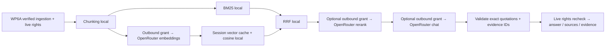

# WP6B-CLOUD — OpenRouter-first Medical RAG

Ngày thực hiện: **2026-11-26, Asia/Bangkok**. Baseline:
`cd089aa0d18f636817669bc73301afa9ed225942`. Branch: `feat/rag-openrouter-cloud`.

**PARTIAL / LIVE API BLOCKED.** Đã triển khai ba adapter và integration; kết quả mock
không phải bằng chứng model OpenRouter thật. Không có opt-in live/budget riêng trong
lượt này; không chạy request trả phí, không gửi corpus y khoa thật. Không đọc/in giá trị
API key trong báo cáo. Lệnh acceptance không opt-in trả `BLOCKED`, `requests: 0`.

## Kiến trúc và phạm vi



| File | Trách nhiệm |
| --- | --- |
| `app/rag/cloud/client.py` | HTTP cố định OpenRouter, key từ environment, timeout, bounded retry/backoff, budget và numeric usage. |
| `cloud/embeddings.py` | Batch/order/dimension validation, L2, fingerprint, cache theo corpus/phiên. |
| `cloud/reranking.py` | Map index về SearchHit local; bỏ provider document/citation. |
| `cloud/generation.py` | LLM chọn trích dẫn nguyên văn, kiểm tra evidence ID và substring; answer/sources riêng. |
| `config.py` | Frozen typed dataclasses, JSON validation, legacy compatibility. |
| `rights.py` | Giữ gate WP6A; bổ sung quyết định external processing trong sidecar hiện có. |
| `service.py` | Điều phối, xác minh lại integrity/quyền từng HTTP attempt và trước trả kết quả. |
| `runtime.py` | Startup dotenv và wiring; không chứa HTTP logic. |
| `live_acceptance.py` | Acceptance tổng hợp có opt-in rõ ràng, tối đa 5 HTTP attempts. |
| `app/ui/rag_page.py` | Retrieval/rerank/ask, escaped evidence/answer/citations, backend/latency/usage. |

Giữ importer, Structured Raw v0.1, chunk identity, công thức BM25/cosine/RRF và repo
Crawler. Không đổi `app/cv/`, CV UI/export, `config/models.json`, preprocessing,
threshold hoặc checkpoint. Không có CV result/ảnh, Clinical Cases hoặc Reports trong
payload OpenRouter. Không triển khai vector database hoặc abstraction provider chung.

## Startup và secret

```powershell
.venv\Scripts\python.exe -m pip install -r requirements-rag.txt
Copy-Item .env.example .env
# Sửa .env trên máy riêng, không dán key vào JSON/chat/frontend.
```

Biến duy nhất cho secret là `OPENROUTER_API_KEY`; cũng có thể đặt qua môi trường
tiến trình. Startup RAG gọi `load_dotenv(project_root / '.env', override=False)`.
`.gitignore` đã có quy tắc `.env`, `.env.*`, `!.env.example`; giữ các quy tắc đó và chỉ
commit placeholder `.env.example`. Không lưu key vào service settings/response/Gradio.
HTTP client không redirect, không nhận endpoint từ JSON/browser, không dùng proxy từ
environment. Exception/status chỉ chứa mã nội bộ, không chứa provider body/document.

Dependencies cloud: `httpx`, `numpy`, `python-dotenv`; cloud mode không import/load
Transformers weights hoặc Cross-Encoder. CV vẫn dùng dependencies riêng của nó.

## JSON configuration và API contract

Production template: [`config/rag.example.json`](../config/rag.example.json).
Synthetic template: [`config/rag.synthetic.example.json`](../config/rag.synthetic.example.json).
Giữ năm paths `manifest`, `artifacts`, `provenance`, `registry`, `approvals`; relative
paths tính từ thư mục chứa JSON. Production bắt buộc đủ năm paths và batch VERIFIED.

Runtime không có JSON mặc định dùng cloud embedding; mẫu mới đề xuất cloud. Để giữ
tương thích, JSON WP6A không ghi `embedding.backend` vẫn là local E5, với prefixes và
tham số cũ. `RAGConfig()`/`EmbeddingConfig()` trực tiếp giữ defaults WP6A; không đổi
ngầm ý nghĩa JSON hoặc caller Python cũ. `embedding.backend="openrouter"` qua JSON
mặc định BGE-M3 với prefixes rỗng. Operator có thể cấu hình prefixes/input types cho
model khác; ứng dụng không tự đoán hỗ trợ `input_type`.

| Setting | Mặc định cloud / ý nghĩa |
| --- | --- |
| `embedding.model`, `provider` | `baai/bge-m3`, `null`; dữ liệu thật yêu cầu provider được pin và duyệt. |
| `embedding.batch_size`, `request_timeout` | 16, 30 giây. |
| `embedding.dimensions` | `null`: suy ra từ response, kiểm tra nhất quán; không giả định 768. Chỉ gửi parameter khi operator cấu hình. |
| `embedding.document_input_type`, `query_input_type` | `null`: không gửi; chỉ bật khi đã kiểm tra model/provider hỗ trợ. |
| `embedding.max_input_bytes` | 2048 UTF-8 bytes cho mỗi input, tính cả prefix. |
| `retrieval.mode`, `top_k` | BM25, 5; browser chọn BM25/Dense/Hybrid và Top-K 1–100. |
| `rrf_k`, `candidates` | 60, 30; giữ công thức deterministic từ WP6A. |
| `reranking.enabled`, `model` | false, `cohere/rerank-v3.5`. |
| `reranking.candidates`, `top_n` | 30, 5; `top_n <= candidates`, tối đa 100. |
| `reranking.fallback_to_hybrid` | false; nếu bật, chỉ lỗi availability mới được trả Hybrid với status DEGRADED rõ ràng. |
| `reranking.max_input_bytes` | 8192 cho mỗi query/document; aggregate bị giới hạn thêm bởi cloud. |
| `generation.enabled`, `model` | false, `openai/gpt-4o-mini`. |
| `generation.temperature`, `max_tokens`, `max_evidence` | 0, 512, 5. |
| `generation.max_input_bytes` | 16000 cho mỗi serialized message, tính cả prompt/evidence JSON. |
| `cloud.max_requests_per_operation` | 12 attempts dùng chung embedding/query/rerank/generation, tính cả retry. |
| `cloud.max_input_chars` | 16000, aggregate input guard cho mỗi adapter invocation, tính cả system prompt của generation. |
| `cloud.max_index_chunks` | 128; vượt cap thì từ chối trước document embedding. |
| `cloud.synthetic_live_opt_in` | false; phải bật riêng cho code-owned synthetic corpus. |
| `cloud.retry_policy` | 2 retries, backoff 0.5s nhân đôi, cap 4s; tối đa cho phép 5 retries. |

Các cap bytes/chars/chunks là **ngân sách operator**, không tuyên bố đó là context limit
của provider. Không cắt/truncate input âm thầm. Khi thay model cần kiểm tra context,
tokenizer/bytes budget, output limit và parameter support từ model card/API; giảm cap
cho phù hợp. Không gọi API metadata mỗi Search và không tải tokenizer/model local.

Chỉ gửi POST tới `https://openrouter.ai/api/v1`:

- `/embeddings`: model, input batch; đọc vector theo `data[].index`, validate count,
  finite numeric values, nonzero L2 và cùng dimension qua batches/query/documents.
  [OpenRouter embeddings reference](https://openrouter.ai/docs/api/api-reference/embeddings/create-embeddings).
- `/rerank`: model, query, documents, top_n; validate unique/bounded indexes và finite
  scores, dùng lại local chunks/offsets/citations.
  [OpenRouter rerank reference](https://openrouter.ai/docs/api/api-reference/rerank/create-rerank).
- `/chat/completions`: model, messages, JSON response, temperature/max_tokens;
  không gửi tools, ảnh, metadata citation hoặc model fallback.
  [OpenRouter chat reference](https://openrouter.ai/docs/api/api-reference/chat/send-chat-completion-request).

Routing luôn `allow_fallbacks=false`; khi provider đã cấu hình dùng `only=[provider]`.
Nếu provider response có tên khác provider đã pin thì từ chối. Embedding lưu reported
provider nếu API cung cấp và từ chối thay đổi giữa document/query. Model response phải
khớp model cấu hình ở cả ba adapter. Nếu API trả canonical ID khác alias, fail-closed;
operator phải kiểm tra và cấu hình đúng ID, không tự mở rộng allowlist.
[OpenRouter provider routing](https://openrouter.ai/docs/guides/routing/provider-selection).

401/402/403/404 trả mã riêng, không retry; 429/5xx/transport timeout có bounded retry.
3xx và lỗi HTTP khác không fallback/redirect. Input/cap/quyền sai không retry.
Numeric telemetry whitelist: request count, prompt/completion/total tokens, search_units,
cost khi API báo. Không suy ra USD từ token count. Request có thể đã tính phí dù timeout;
đặt retries=0 nếu cần tránh lặp billable attempt. Cap requests/tokens không phải hard
dollar cap; operator cần spending limit của tài khoản/key OpenRouter.

## Rights gate và quyết định outbound

`RegistryRights` vẫn yêu cầu Crawler registry cho read/internal_storage/reuse/ai_use,
indexing sidecar gắn đúng record/original hash, review hợp lệ, full_text và partial
review khi cần. Metadata-only/PubMed/failed extraction tiếp tục bị chặn như WP6A.

Không đổi version sidecar `wp6a-indexing-1`. Reviewer thêm `external_processing` vào
**đúng document grant** trong file approvals hiện có; không lấy quyền từ batch record.
Ví dụ cấu trúc sau là placeholder, không phải quyết định cấp quyền:

```json
{
  "external_processing": {
    "status": "allowed",
    "destination": "https://openrouter.ai/api/v1",
    "patient_identifiers": "absent_reviewed",
    "reviewer_id": "REPLACE_WITH_AUTHORIZED_REVIEWER",
    "evidence": "REPLACE_WITH_REVIEWED_RIGHTS_AND_PRIVACY_EVIDENCE",
    "reviewed_at": "2026-11-26T00:00:00Z",
    "review_again_at": "2026-12-26T00:00:00Z",
    "routes": [
      {"action": "embedding", "model": "baai/bge-m3", "provider": "EXACT_APPROVED_PROVIDER"},
      {"action": "reranking", "model": "cohere/rerank-v3.5", "provider": "EXACT_APPROVED_PROVIDER"},
      {"action": "generation", "model": "openai/gpt-4o-mini", "provider": "EXACT_APPROVED_PROVIDER"}
    ]
  }
}
```

Reviewer chịu trách nhiệm bằng chứng về quyền external processing, thẩm quyền, đích,
privacy và model/provider. Strings trên phải được thay sau review, với `provider`
khớp JSON từng adapter. Không tự cấp quyền hoặc dùng fixture cho corpus thật.
Missing/null provider, missing/duplicate route, revoked/expired/future review,
privacy unknown, sai destination/model/hash đều đóng gate. Thu hồi bằng `status=revoked`,
xóa grant/route hoặc thay registry/indexing grant; lần operation kế tiếp áp dụng ngay.

Mỗi HTTP attempt, kể cả retry, xác minh lại receipts/artifacts/provenance và quyền.
Document embedding kiểm tra toàn corpus đang index; rerank kiểm tra mọi candidate;
generation kiểm tra mọi evidence. Kiểm tra lại sau response và trước trả kết quả.
Nếu có thu hồi giữa request thì hủy answer/hits/sources và cache. Plain BM25 chỉ dùng
quyền local; outbound chưa được duyệt không ngăn BM25. Query có email, số định danh dài
hoặc mẫu tên/ID bệnh nhân rõ ràng bị chặn trước cloud; đây là guard bổ sung, không phải
bộ khử định danh hoàn chỉnh. Chỉ dùng câu hỏi đã loại thông tin bệnh nhân.

Synthetic chỉ được `SyntheticRights` nhận khi đúng toàn bộ fixed record/hash trong code;
đặt label/source_id giống demo không cấp quyền. Opt-in chỉ dành cho corpus đó. Dữ liệu
thật không kế thừa opt-in synthetic. BM25 demo không cần opt-in/key.

## Vector cache và vòng đời

Cache NumPy trong RAM thuộc **một RAGService/phiên**; không có cache/index dùng chung
hoặc lưu disk. Identity bao gồm UUID corpus/session, chunk ID + content hash + record
hash, chunk config/version, fingerprint model/provider/routing/prefix/input_type/
dimensions/normalization, dimension thực tế và reported provider nếu có.

Search tiếp theo dùng document vectors đã cache; query được embed mỗi lần, không lưu
lịch sử câu hỏi. Các chunk có cùng text trong một corpus dùng chung vector, provenance
của SearchHit vẫn riêng. Content/chunk config thay đổi loại entries cũ và chỉ embed
missing content; thay model/config/corpus xóa cache và rebuild. Ingest/remove/close xóa
cache; close/TTL dọn synthetic directory. Revocation local loại chunk/vector; outbound
revocation xóa cloud cache/index cả khi operation tiếp theo là BM25. RRF không đổi.

RAM cache tránh chi phí lặp trong cùng phiên; reload app hoặc mở phiên mới cần index
lại sau khi kiểm tra quyền/caps. Chưa có cache xuyên restart. Không có daemon theo dõi
rights: quyết định được kiểm tra tại operation boundaries. Không thể thu hồi byte đã
gửi trước đó hoặc đoạn browser đã nhận; operator phải dừng phiên theo quy trình nếu
cần thu hồi tức thì. Không có atomic transaction với file reviewer/OpenRouter.

## Grounded answer và giới hạn

Evidence IDs `E1...En` gán bởi server cho local hits. Prompt system tách riêng;
question/evidence chỉ là JSON data trong user message, không được ghép thành system
instruction. Provider không được cung cấp citation metadata.

WP6B chọn **extractive grounded generation**: LLM trả JSON gồm evidence_id và quote.
Chỉ render quote đúng substring chunk tương ứng; citation IDs sai, trùng, quote bịa,
field metadata thừa, output bị cắt hoặc JSON sai đều bị từ chối. Các nguồn trả riêng
trong `SearchResponse.sources`, answer riêng trong `.answer`; metadata lấy từ local
SearchHit. UI phân biệt LLM lựa chọn và nguồn tài liệu; escape mọi HTML/string untrusted.

Đây là lựa chọn thận trọng có chủ đích: chưa bật văn xuôi lâm sàng tự do vì kiểm tra
citation tồn tại không chứng minh kết luận đúng. Không tự tạo PMID/DOI/page/author/URL,
không tự chẩn đoán/đề xuất điều trị. Missing evidence hoặc LLM abstain trả thông báo
thiếu bằng chứng. Exact quote không chứng minh relevance, entailment, tính đúng y khoa
hay immunity tuyệt đối trước prompt injection; cần đánh giá riêng ở WP6C. Tài liệu có
instruction độc hại vẫn là untrusted evidence, không phải quyền thực thi.

## Chạy Synthetic Demo và Gradio

Offline, không có key hoặc request trả phí:

```powershell
.venv\Scripts\python.exe -m app.rag --demo --mode BM25 --no-rerank --query 'tổn thương da'
```

Để test cloud thủ công, copy synthetic JSON vào `runtime/wp6b/demo.json`, reviewer/
operator tự bật `cloud.synthetic_live_opt_in=true`, `reranking.enabled=true` và
`generation.enabled=true` sau khi quyết định ngân sách. Không ghi key trong JSON.

```powershell
.venv\Scripts\python.exe -m app.rag --demo --settings runtime/wp6b/demo.json --mode Hybrid --rerank --ask --query 'source evidence'
Remove-Item Env:RAG_CONFIG -ErrorAction SilentlyContinue
$env:RAG_SYNTHETIC_DEMO = '1'
$env:RAG_DEMO_CONFIG = (Resolve-Path runtime/wp6b/demo.json).Path
$env:LESION_PORT = '7872'  # Chọn port còn trống, không dùng 7860/7861 hiện có.
$env:LESION_RUNTIME_DIR = (Join-Path (Get-Location) 'runtime/wp6b/manual-ui')
.venv\Scripts\python.exe main.py
```

UI có mode BM25/Dense/Hybrid, Top-K, Reranking, Retrieve Only/Ask with Evidence, evidence,
answer, citations, backend/model, latency và API usage. Rerank checkbox chỉ interactive
khi operator đã bật. Ask bị từ chối khi generation chưa bật. Cloud lỗi không tự đổi
Dense/Hybrid thành BM25. Fallback rerank chỉ khi được cho phép và status hiển thị DEGRADED.
Với dữ liệu thật, tắt demo, xóa `RAG_DEMO_CONFIG`, đặt `RAG_CONFIG` tới production JSON.

Acceptance trả phí chỉ sau opt-in rõ ràng và key có spending limit nhỏ:

```powershell
.venv\Scripts\python.exe -m app.rag.live_acceptance
# BLOCKED, requests=0; lệnh này đã chạy trong lượt triển khai.

# Chỉ operator chạy sau khi sẵn sàng trả phí:
.venv\Scripts\python.exe -m app.rag.live_acceptance --live --budget-confirmed --settings config/rag.synthetic.example.json
```

Hai flags là opt-in riêng cho fixed synthetic corpus và xác nhận ngân sách; command
chỉ bật feature flags trong memory, không sửa file/cấp quyền cho corpus thật. Một
document embedding batch + một Dense query, sau đó cached Hybrid query + rerank + chat:
tối đa **5 actual HTTP attempts tổng cộng**, retries=0, corpus tối đa 16 chunks,
aggregate input cap 8000 chars, output 512 tokens. Lưu report JSON status/stages/count/
numeric usage, không log request/response text. Không load test hoặc index corpus lớn.
FAIL/BLOCKED dừng sớm; PASS chỉ sau nhận đủ nguồn đã xác minh từ API thật.

## Kiểm thử và bằng chứng

| Mốc | Triển khai / mock | Live model |
| --- | --- | --- |
| WP6B.1 embedding + Dense/Hybrid + cache | Có tests độc lập vector/order/cache/model/session/rights, BM25/RRF regression | BLOCKED: thiếu live/budget opt-in riêng |
| WP6B.2 rerank | Có tests mapping/index bounds/duplicates/fallback/rights | BLOCKED: chưa gọi API thật |
| WP6B.3 grounded generation | Có tests exact quotes/citations/prompt boundary/abstention/rights | BLOCKED: chưa gọi API thật |

Test HTTP dùng `httpx.MockTransport`, fake key test-only và numeric fake usage. Không
dùng kết quả mock làm chứng cứ API thật; test mock của live acceptance chỉ xác minh
wiring/cap năm requests. Không có cost thực tế được API báo trong lượt này.

Kết quả thực chạy (các dòng có ca trùng nhau, không cộng tổng):

| Lượt | Kết quả | Thời gian |
| --- | --- | --- |
| Toàn bộ tests, bật checkpoint CV thật E1/E2/E3 + SegFormer và Chromium | **450 passed, 3 skipped**, 2 Pillow deprecation warnings | 257.27s |
| RAG sau hardening model/provider, demo JSON và mock live acceptance | **179 passed** | 35.65s |
| RAG delivery gồm bổ sung stage-specific rights, retry revocation, cache hai phiên và Chromium | **184 passed** | 57.68s |
| `python -m compileall -q app/rag app/ui/rag_page.py`, `pip check`, `git diff --check` | PASS | — |
| Protected SHA-256 snapshot | **113/113 files không đổi** | — |
| Live acceptance không flags | **BLOCKED**, 0 OpenRouter requests, không có actual usage/cost | — |

Full regression chạy trước hardening cuối; sau thay đổi cloud/UI đã chạy lại nhóm RAG
và Chromium liên quan. CV code/assets không đổi. Full suite gồm SegFormer + E2 coexist/
PNG export, E1/E2/E3 CPU inference, registry rollback trên bản sao, hai dual-model
browser entrypoints và UI visualization/download. Ba skip: E1 pilot artifact thiếu,
Windows symlink privilege thiếu và E5 local thiếu weights. E5 không cần cho cloud.

Logs local gitignored ở `runtime/wp6b/`: `cloud-unit.txt`, `cloud-service.txt`, `full.txt`,
`full.xml`, `final-rag.txt`, `final-rag.xml`, `rag-delivery.txt`, `rag-delivery.xml`,
`live-acceptance.json`, `protected-before.json`, `protected-after.json`. Thư mục pytest
riêng khắc phục quyền truy cập Temp mặc định. Hai server 7860/7861 vẫn giữ PID
34584/27432 sau regression; test dùng port trống và đã dừng test servers.

Chạy lại regression gồm checkpoint CV thật đang có (không tải weights):

```powershell
$env:OMP_NUM_THREADS = '4'
$env:MKL_NUM_THREADS = '4'
$env:PYTHONUTF8 = '1'
$env:GRADIO_ANALYTICS_ENABLED = 'False'
$env:HF_HUB_OFFLINE = '1'
$env:TRANSFORMERS_OFFLINE = '1'
$env:CV_SMOKE_REGISTRY = (Resolve-Path config/models.json).Path
$env:WP2_SMOKE_CHECKPOINT = (Resolve-Path model_store/segformer/real_only/best.pt).Path
$env:WP2_SMOKE_IMAGE = (Resolve-Path model_store/wp2-verification/dermoscopy.jpg).Path
$env:WP2_SMOKE_DEVICE = 'cpu'
$env:WP_CV4_REAL = '1'
.venv\Scripts\python.exe -m pytest tests -q -ra --basetemp runtime/wp6b/regression-new --junitxml runtime/wp6b/regression-new.xml
```

Các browser tests tự chọn port trống/runtime tách biệt; không dùng server 7860/7861.
Real E5 không phải điều kiện cloud và vẫn BLOCKED khi weights local thiếu. Pilot CV
chưa có artifact vẫn phải báo skip/BLOCKED, không đổi checkpoint để vượt test.

## Git, bảo toàn và WP6C

Không push/merge. `.gitignore` đã có thay đổi từ người dùng đúng các rule yêu cầu;
giữ nội dung và đưa vào security commit. Notebook và thư mục Faster R-CNN chưa commit
không stage. Chụp SHA-256 113 files thuộc CV code/UI, registry, model_store, notebook và
thư mục Faster R-CNN trước triển khai; đã đối chiếu sau regression: **113/113 không đổi**. Registry CV giữ SHA-256
`07ee693b8a01b043dc36a67f2c336092cde1b670454ff55951773334f5f35350`.

Các commit chức năng trước docs/tests:

- `aa14038`: security, typed config, dependencies và cloud JSON.
- `38edeec`: bounded transport, embeddings và cache.
- `9b329a9`: reranking mapping/provenance.
- `9419299`: grounded quotations và response contracts.
- `91855c1`: outbound gate, Hybrid/service/runtime integration.
- `1216c2e`: Gradio/CLI và explicit live acceptance.
- `aa2ffd9`: response model/provider validation, dimension/provider cache identity và demo JSON wiring.
- Commit tests/docs cuối: xem `git log -1` trên branch này (tránh self-referential hash).

Trước corpus thật: reviewer phải bổ sung evidence external/privacy theo hash, pin
provider/model, xác minh model limits và account spending limits; chạy live synthetic
acceptance trước. Không kế thừa trạng thái VERIFIED từ tài liệu WP6A/E5 trước đây.

WP6C: lập corpus có quyền đã duyệt và câu hỏi/ground truth độc lập; so sánh BM25/Dense/
Hybrid/rerank bằng Recall@K/MRR/nDCG, đánh giá relevance/abstention/citation support,
prompt injection và truy vấn định danh, đo latency/cost thực theo stage. Chỉ mở rộng
sang grounded synthesis sau khi có phương pháp kiểm chứng entailment và review y khoa.
Không dùng smoke image/corpus tổng hợp làm benchmark chất lượng lâm sàng.
